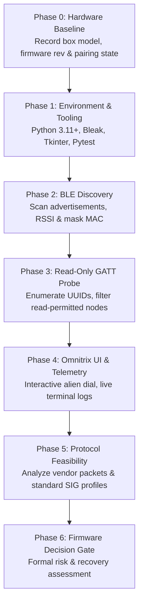
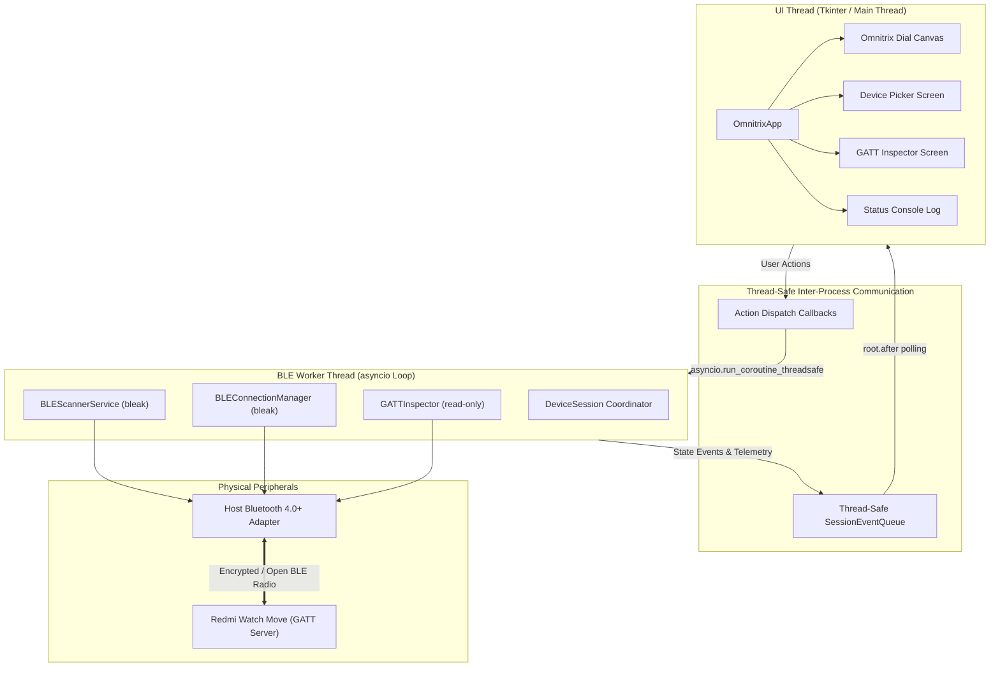

# 🌌 OMNITRIX WATCH // RESEARCH PLATFORM & COMPANION OS

<div align="center">

```ascii
   ██████╗ ███╗   ███╗███╗   ██╗██╗████████╗██████╗ ██╗██╗  ██╗
  ██╔═══██╗████╗ ████║████╗  ██║██║╚══██╔══╝██╔══██╗██║╚██╗██╔╝
  ██║   ██║██╔████╔██║██╔██╗ ██║██║   ██║   ██████╔╝██║ ╚███╔╝ 
  ██║   ██║██║╚██╔╝██║██║╚██╗██║██║   ██║   ██╔══██╗██║ ██╔██╗ 
  ╚██████╔╝██║ ╚═╝ ██║██║ ╚████║██║   ██║   ██║  ██║██║██╔╝ ██╗
   ╚═════╝ ╚═╝     ╚═╝╚═╝  ╚═══╝╚═╝   ╚═╝   ╚═╝  ╚═╝╚═╝╚═╝  ╚═╝
                W  A  T  C  H     O  S     v  0  .  1  .  0
```

[](https://www.python.org/)
[](https://github.com/hbldh/bleak)
[](LICENSE)
[](#-safety-first-the-four-prime-directives)
[](#-system-prerequisites)
[](#-testing-suite)
[](CONTRIBUTING.md)

**A Galvan-grade research companion and Ben 10 / Omnitrix-themed desktop interface for exploring the Redmi Watch Move over Bluetooth Low Energy (BLE).**

[Features](#-key-features) • [Quick Start](#-quick-start) • [The 7-Phase Process](#-the-7-phase-research-process) • [Architecture](#-system-architecture) • [Open Source Ecosystem](#-open-source-files--governance) • [Safety Directives](#-safety-first-the-four-prime-directives)

</div>

---

```ascii
                    .-------------------------.
                   /   _____________________   \
                  /   /  _________________  \   \
                 |   |  /   \         /   \  |   |
                 |   | |     \  OMNI /     | |   |
                 |   | |      \  OS /      | |   |
                 |   | |  <==  [===]  ==>  | |   |
                 |   | |      /  GATT \    | |   |
                 |   | |     /  PROBE  \   | |   |
                 |   |  \___/___________\__/  |   |
                  \   \_____________________/   /
                   \                           /
                    '-------------------------'
                     [STATUS: READY // GREEN]
```

---

## ⚡ Executive Summary

**Omnitrix Watch** transforms reverse-engineering and companion device exploration into a secure, cyberpunk-inspired visual experience. Built to interface with the **Redmi Watch Move**, it bridges native host Bluetooth controllers with a responsive Tkinter GUI styled after Azmuth’s iconic alien DNA matrix.

Unlike arbitrary packet injection scripts, this repository implements a strictly verified, **non-destructive read-only GATT discovery protocol**. You can safely audit nearby Bluetooth peripherals, enumerate manufacturer and Bluetooth SIG services, inspect telemetry characteristics, and export sanitized Markdown reports without risking bricking your smartwatch.

---

## 🛡️ Safety First: The Four Prime Directives

Embedded reverse engineering carries inherent hardware risks. This repository enforces Azmuth's 4 Prime Directives across all modules:

> [!IMPORTANT]
> 1. **Zero Destructive Commands (Read-Only):** Initial research is strictly read-only. No raw GATT writes, configuration overwrites, or fuzzing payloads are issued to unknown endpoints.
> 2. **No Unofficial Firmware Flashing:** BLE access does **not** equal bootloader flashing. Do not attempt unauthenticated OTA flashing or exploit chains.
> 3. **Privacy-Preserving Telemetry:** Hardware MAC addresses are dynamically masked (`XX:XX:**:**:**:XX`). No personal health metrics, authentication tokens, or encryption handshakes are committed or transmitted.
> 4. **User-Explicit Target Selection:** The engine never blindly connects to or probes ambient devices. Every connection requires manual user selection and confirmation.

---

## ✨ Key Features

- 🟢 **Omnitrix Alien UI:** Full-screen cyberpunk dark theme (`#080c0a`) with glowing neon dial canvas, live mode status indicators, and sound-wave styled terminal logs.
- 📡 **Asynchronous BLE Engine:** Multi-threaded architecture combining Python `asyncio` and `bleak` in a background worker thread, ensuring the GUI never freezes.
- 🔍 **Safe GATT Inspector:** Automatically detects Bluetooth SIG Standard Services (Battery, Device Info, Heart Rate) and Xiaomi/Huami vendor services (`0xFEE0`, `0xFE95`, `0xFDAB`).
- 🛡️ **Dynamic Address Masking:** Anonymizes peripheral MAC addresses in real-time across UI tables, logs, and exports.
- 📑 **One-Click Markdown Exporter:** Automatically compiles discovered services and readable characteristics into formatted tables at `docs/gatt-inventory.md`.
- 💻 **Dual Mode (GUI & Headless CLI):** Run the complete graphical dashboard or run automated discovery directly from PowerShell/Bash.

---

## 🚀 Quick Start

### 📋 System Prerequisites
- **Python:** 3.11 or later (tested on Python 3.11, 3.12, 3.13, and 3.14).
- **Bluetooth Adapter:** BLE 4.0+ hardware enabled on Windows 10/11 or Linux (BlueZ).
- **Execution Policy:** RemoteSigned permissions on Windows PowerShell.

---

### 🖱️ One-Click Experience (No Setup Required!)

We made running and distributing Omnitrix Watch effortless for anyone:

1. **One-Click Launch:** Simply double-click **`Launch-Omnitrix.bat`** in File Explorer!
   - Automatically detects Python, activates `.venv`, verifies dependencies, and boots the Omnitrix GUI.
2. **One-Click Desktop Shortcut:** Double-click **`Create-Desktop-Shortcut.bat`**!
   - Automatically drops an `Omnitrix Watch` icon onto your Windows Desktop.
3. **Standalone Portable Release (Zero Python Installed):**
   - Download `OmnitrixWatch-v0.1.0-windows-x64.zip` from [Releases](https://github.com/), extract it, and double-click **`Run-Omnitrix.bat`**!

---

### 💻 Fast Virtual Environment Setup (PowerShell)

Activate the project environment in one command:

```powershell
(Set-ExecutionPolicy -Scope Process -ExecutionPolicy RemoteSigned) ; (& p:\omniwatch\.venv\Scripts\Activate.ps1)
```

Upgrade package manager and install dependencies in editable mode:

```powershell
python -m pip install --upgrade pip
pip install -e ".[dev]"
```

*For Linux / macOS bash users:*
```bash
source .venv/bin/activate
python -m pip install --upgrade pip
pip install -e ".[dev]"
```

---

### 🎮 Running the Omnitrix Interface

Launch the graphical desktop application:

```powershell
python -m omnitrix_watch.main
```

Or using the installed console binary:

```powershell
omnitrix-watch
```

#### 🕹️ Headless Command Line BLE Scanner

Test Bluetooth adapter connectivity without launching the GUI:

```powershell
# Quick 5-second scan of all nearby BLE devices
python -m omnitrix_watch.main --cli-scan --duration 5.0

# Target filter specifically for Redmi/Xiaomi wearables
python -m omnitrix_watch.main --cli-scan --duration 8.0 --filter "Redmi"
```

---

## 🔄 The 7-Phase Research Process

Every stage of the Omnitrix Watch framework is guided by the structured protocol outlined in [`AGENT.md`](AGENT.md):



### Detailed Phase Breakdown:

1. **Phase 0 — Baseline Hardware Characterization:**
   - Document watch serial prefix, box model numbers, firmware version, and pairing state in [`docs/device-notes.md`](docs/device-notes.md).
2. **Phase 1 — Isolated Environment & Dependencies:**
   - Establish a self-contained virtual environment with minimal dependencies (`bleak`, `pytest`, standard `tkinter`).
3. **Phase 2 — Non-Invasive BLE Discovery:**
   - Broadcast listener registers advertisement packets, local device names, and RSSI signal strengths without connecting.
4. **Phase 3 — Safe GATT Enumeration:**
   - Upon explicit selection, perform read-only queries on GATT characteristics advertising the `read` flag. Strictly skip write characteristics.
5. **Phase 4 — Omnitrix Visual Dashboard:**
   - Present discovered attributes inside an Omnitrix interface featuring green bezel dials, collapsible service trees, and status badges.
6. **Phase 5 — Protocol Feasibility Analysis:**
   - Map observed UUIDs against documented Bluetooth SIG specifications and known wearable ecosystems in [`docs/protocol-hypotheses.md`](docs/protocol-hypotheses.md).
7. **Phase 6 — Firmware Decision Gate:**
   - Strictly prohibit firmware tampering unless authoritative vendor recovery methods and complete bootloader specifications are verified.

---

## 🏗️ System Architecture

Omnitrix Watch enforces clean separation between asynchronous hardware I/O and synchronous UI rendering:



---

## 🌐 Open Source Files & Governance

This project is an open source initiative welcoming community researchers, designers, and embedded enthusiasts. The repository includes a full suite of open-source standard files:

| Document | Purpose & Description |
|---|---|
| [`LICENSE`](LICENSE) | The **MIT License** granting full freedom to use, modify, distribute, and build upon this tool. |
| [`CONTRIBUTING.md`](CONTRIBUTING.md) | Contribution workflow, PR lifecycle, coding standards (PEP 8, type hints), and hardware safety guidelines. |
| [`CODE_OF_CONDUCT.md`](CODE_OF_CONDUCT.md) | **Contributor Covenant v2.1** ensuring a welcoming, inclusive, and harassment-free community environment. |
| [`SECURITY.md`](SECURITY.md) | Vulnerability disclosure guidelines, responsible hardware handling, and non-destructive research policies. |
| [`AGENT.md`](AGENT.md) | Master autonomous engineering roadmap, acceptance criteria, and technical constraints. |
| [`docs/device-notes.md`](docs/device-notes.md) | Template for tracking target smartwatch hardware revisions, OS versions, and pairing configurations. |
| [`docs/ble-scan-findings.md`](docs/ble-scan-findings.md) | Log of observed advertising intervals, company identifiers, and local name packets. |
| [`docs/gatt-inventory.md`](docs/gatt-inventory.md) | Master sanitized table of all enumerated services, characteristics, and readable values. |
| [`docs/protocol-hypotheses.md`](docs/protocol-hypotheses.md) | Reverse-engineering notes on Xiaomi/Huami packet framing and service semantics. |
| [`docs/firmware-research.md`](docs/firmware-research.md) | Prerequisites and risk assessment gate for firmware update analysis. |

---

## 🧪 Testing Suite

Unit tests validate configuration loaders, data models, privacy masking, and Markdown generation without requiring a physical watch:

```powershell
pytest -v
```

**Test Coverage Summary:**
- `test_config.py`: Validates default and custom TOML settings parsing.
- `test_device_models.py`: Validates MAC masking (`XX:XX:**:**:**:XX`), display names, and GATT permission checks (`is_readable`, `is_writable`).
- `test_gatt_inventory_format.py`: Verifies Markdown table generation and sanitization.

---

## 🗂️ Repository Directory Anatomy

```text
omnitrix-watch/
├── .gitignore                      # Git exclusion rules (venv, cache, logs)
├── LICENSE                         # Official MIT Open Source License
├── README.md                       # High-voltage documentation & visual guide
├── CONTRIBUTING.md                 # Open source collaboration & safety guide
├── CODE_OF_CONDUCT.md              # Contributor Covenant v2.1 pledge
├── SECURITY.md                     # Vulnerability reporting & safety boundaries
├── AGENT.md                        # Master Galvan engineering specifications
├── pyproject.toml                  # PEP 621 packaging metadata & CLI scripts
│
├── config/                         # Configuration
│   └── app.example.toml            # Config template with timeout & theme options
│
├── docs/                           # Research Documentation
│   ├── ble-scan-findings.md        # Raw advertisement observations
│   ├── device-notes.md             # Baseline hardware & companion info
│   ├── firmware-research.md        # Risk & safety assessment rules
│   ├── gatt-inventory.md           # Sanitized GATT service table
│   └── protocol-hypotheses.md      # Protocol & framing hypotheses
│
├── logs/                           # Runtime Logging
│   └── .gitkeep                    # Retains folder in git (logs are gitignored)
│
├── src/                            # Package Source Code
│   └── omnitrix_watch/
│       ├── __init__.py             # Package init & version (0.1.0)
│       ├── main.py                 # Application launcher (CLI & GUI)
│       ├── config.py               # TOML configuration loader
│       ├── logging_setup.py        # Privacy-safe logging system
│       ├── ble/                    # Asynchronous BLE Layer
│       │   ├── scanner.py          # Device discovery service
│       │   ├── connection.py       # Connection lifecycle manager
│       │   ├── gatt_inspector.py   # Read-only characteristic reader
│       │   └── permissions.py      # SIG UUID maps & permission checks
│       ├── models/                 # Domain Data Models
│       │   └── device.py           # DeviceSummary & GattInventory models
│       ├── services/               # Thread Orchestration
│       │   └── device_session.py   # Async worker & event queue
│       └── ui/                     # Tkinter Visual Dashboard
│           ├── app.py              # Root application controller
│           ├── theme.py            # Omnitrix color schemes & font styling
│           └── screens/            # Modular UI screens
│               ├── home.py         # Main dial dashboard
│               ├── device_picker.py# Discovered peripheral selector
│               └── device_details.py# GATT treeview & inventory export
│
└── tests/                          # Automated Pytest Suite
    ├── __init__.py
    ├── test_config.py              # Config unit tests
    ├── test_device_models.py       # Data model unit tests
    └── test_gatt_inventory_format.py# Markdown exporter unit tests
```

---

## 🤝 Contributing & Community

Contributions are what make the open-source community thrive! Whether you're designing alien dial widgets, adding standard Bluetooth SIG UUID definitions, or optimizing BLE reconnection logic:

1. **Fork** the project on GitHub.
2. Create your Feature Branch: `git checkout -b feature/galvan-enhancement`
3. Commit your changes: `git commit -m 'feat: add alien selection dial animation'`
4. Push to the Branch: `git push origin feature/galvan-enhancement`
5. Open a **Pull Request** and reference our [Contribution Guidelines](CONTRIBUTING.md).

---

## ⚖️ Legal & Disclaimer

> [!NOTE]
> - **Ben 10 / Omnitrix** is a registered trademark of Cartoon Network / Warner Bros. Discovery. This software is an independent, non-commercial fan research and educational prototype. No proprietary artwork, assets, or trademarks are redistributed.
> - **Redmi & Xiaomi** are registered trademarks of Xiaomi Inc. This project is not affiliated with, endorsed by, or sponsored by Xiaomi Inc.
> - Always respect local wireless regulations and device ownership boundaries. Never probe or intercept devices you do not own or have explicit authorization to inspect.

<div align="center">

**Built with 💚 by the Omnitrix Watch Research Team**  
*It's Hero Time.*

</div>
